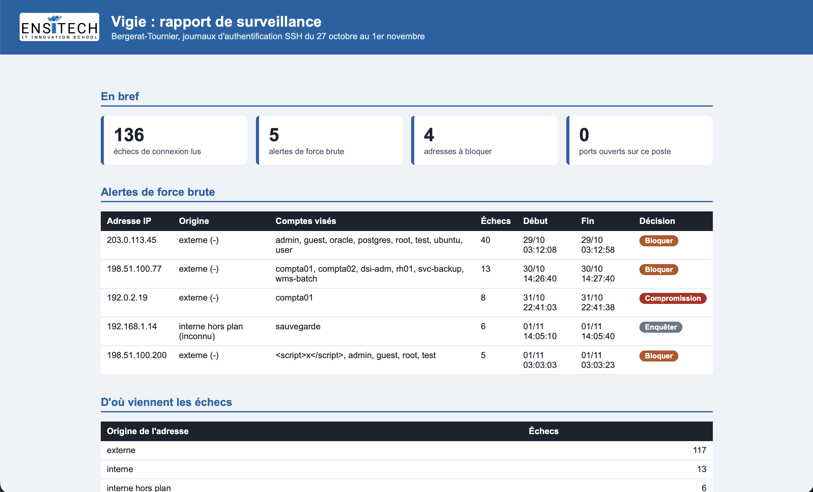
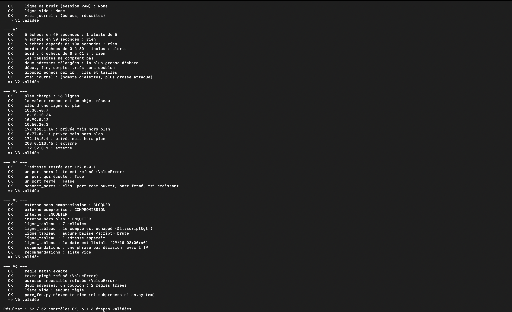

<!--
Modèle de README pour ton portfolio. Garde ce fichier à la racine de ton projet,
remplace tout ce qui est entre [crochets], supprime les lignes qui ne te concernent pas
et ce commentaire. Écris avec tes mots : un jury lit des dizaines de README et repère
tout de suite ceux qui sont recopiés.
-->

# Vigie, console de surveillance réseau

Outil en Python qui lit le journal de connexions SSH d'un distributeur de pièces industrielles
(cas fictif Bergerat-Tournier), repère les adresses qui attaquent, vérifie les adresses source
contre le plan d'adressage, teste quelques ports de la machine locale et produit un rapport HTML.

Réalisé par [Prénom Nom], BTS SIO 1re année, [option SLAM ou SISR], [établissement], [mois année].

## Ce que fait l'outil

| Étape | Fichier | Ce qu'elle fait |
|---|---|---|
| V1 | `vigie/journal.py` | lit une ligne du journal et la transforme en événement |
| V2 | `vigie/detection.py` | repère les adresses avec au moins 5 échecs en 60 secondes |
| V3 | `vigie/reseau.py` | classe une adresse : interne (et dans quel site), ou externe |
| V4 | `vigie/ports.py` | teste une liste fermée de ports sur 127.0.0.1 uniquement |
| V5 | `vigie/rapport.py` | écrit le rapport HTML avec les alertes |
| V6 | `vigie/pare_feu.py` | propose des règles de pare-feu, en texte, sans les appliquer |

## Captures

## Lancer le projet

Windows, rien à installer à part le dossier `python\` du kit (il n'est pas dans le dépôt : ce sont
des binaires, ils n'ont rien à faire dans Git).

1. Télécharger le dépôt et l'extraire.
2. Copier le dossier `python\` du kit à la racine du projet.
3. Double-cliquer sur `lancer.bat`. Le rapport est écrit dans `rapports\`.
4. `verifier.bat tout` vérifie les six étapes.

## Organisation du code

[Explique en quelques lignes : un fichier par étape, `outils.py` pour les fonctions communes,
`donnees\` pour le journal et le plan d'adressage.]

## Choix techniques

- [Pourquoi tu as découpé le journal avec telle méthode (split, expression régulière, autre).]
- [Comment tu as choisi de compter les échecs dans une fenêtre de 60 secondes.]
- [Ce que tu as fait pour qu'un nom d'utilisateur hostile ne casse pas le rapport HTML.]

## Sécurité

- Le test de ports ne vise que `127.0.0.1` : le code refuse toute autre adresse.
- Sonder le réseau d'un tiers sans accord est une infraction (article 323-1 du Code pénal).
- Les règles de pare-feu sont affichées, jamais exécutées.
- Les adresses externes des données sont des adresses de documentation (RFC 5737), pas de vraies machines.

## Tests effectués

| Test | Résultat |
|---|---|
| `verifier.bat tout` | [x / y contrôles OK] |
| Rapport comparé à ce que tu attends à la main | [ce que tu as constaté] |
| Un nom d'utilisateur avec des balises HTML | [ce que tu as constaté] |

## Ce que j'ai appris

[Trois ou quatre phrases à toi : ce qui t'a bloqué, comment tu t'en es sorti, ce que tu referais autrement.]

## Compétences du référentiel

[Reprends les compétences de ta fiche de réalisation E5 qui s'appliquent ici.]
